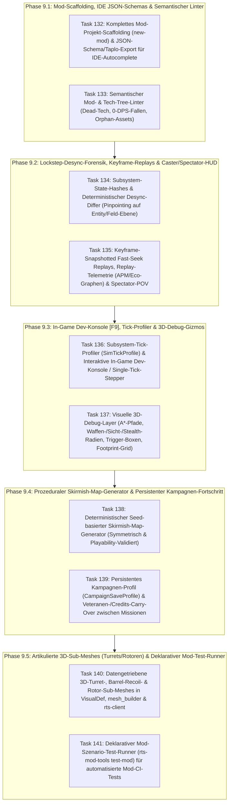

# Architektur- & Umsetzungsplan v2 (Phase 9): Studio-Grade RTS-Engine & Mod-SDK Komplettierung

## Festgelegte Architektur-Entscheidungen (nach `/grill-me` Review)
1. **Kompakte `.replay.json` auf Disk + In-Memory-Keyframe-Cache im RAM (Task 135):** Replay-Dateien speichern auf Disk weiterhin nur `tick_commands`, `content_hash`, `players_setup` und kompakte `telemetry_samples`, während `ReplayKeyframeCache` (alle 100 Ticks) automatisch im RAM aufgebaut wird (`O(1)` Fast-Seek ohne Dateigrößen-Explosion).
2. **Dev-Konsole `[F9]` mit Multiplayer-Lockstep-Schutz (Task 136):** Im Singleplayer/Skirmish/Studio sind alle zustandsverändernden Konsolenbefehle (`spawn`, `credits`, `var`, `trigger`, `god`, `instant_build`, `reveal`, `step [N]`) aktiv; in einer laufenden Multiplayer-Lockstep-Sitzung schaltet `[F9]` automatisch in den **Read-Only Profiler- & Desync-Diagnose-Modus**.
3. **Hybride 3D-Turret-, Barrel-Recoil- & Rotor-Architektur (Task 140):** `VisualDef` (`has_turret`, `barrel_recoil_distance`, `spin_speed_deg_per_sec`) steuert automatisch artikulierte Bevy-Child-Sub-Meshes (`TurretVisualChild` / `RotorVisualChild`) für alle bestehenden/prozeduralen Modelle und bindet zusätzlich benannte glTF-Child-Nodes (`"Turret"`, `"Barrel"`, `"Rotor"`) ein, falls ein externes `.glb` diese besitzt.

## Überblick & Diagnose: Was nach Phase 8 noch für eine erstklassige RTS-Engine & ein professionelles Dev/Mod-Kit fehlt

Nach Abschluss von **Phase 7** (Engine/Mod-Entkopplung) und **Phase 8** (Audio/L10n, `extends`-Vererbung, `[F12]` Hot-Reload, 3D-Editor v2, Balance-Analyzer, KI-Profile, Group-Path-Caching, Kampagnen-Direktor mit 1:1 Rhai/Lua-Parität) ist das Fundament komplett datengetrieben.

Bei einem gezielten Architektur-Audit gegen moderne Referenz-RTS-Engines und Mod-SDKs (OpenRA, Beyond All Reason / Spring, StarCraft II Editor, C&C WorldBuilder) zeigen sich **5 konkrete Bereiche**, die definitiv noch in die Engine und das Dev/Mod-Kit gehören:

---

## Die 5 Säulen im Detail

### Säule 1: Komplettes Projekt-Scaffolding (`new-mod`), IDE JSON-Schemas (`generate-schema`) & Semantischer Tech-Tree-Linter (Phase 9.1)
- **Ist-Zustand:** [`scaffold.rs`](file:///d:/projekt/rust-rts/engine/crates/rts-asset-pipeline/src/scaffold.rs) erzeugt bisher nur ein einzelnes Einheiten-Snippet (`scaffold-unit`). Zudem fehlt Moddern beim Bearbeiten von `.toml`-Katalogen in VS Code / JetBrains (Taplo / Even Better TOML) eine maschinenlesbare Schema-Definition für Autovervollständigung und Typprüfung.
- **Lösung (Tasks 132–133):**
  1. **`rts-mod-tools new-mod <id>`:** Erzeugt wahlweise eine eigenständige Total-Conversion-Mod (`--template standalone`) oder eine Sub-Mod (`--extends rust-ra2`) inklusive komplettem Ordnerbaum, spielbarer Startkarte, Fraktionen, Beispiel-Einheiten/Gebäuden, `.glb`-Modellen und `.taplo.toml`.
  2. **`rts-mod-tools generate-schema --output-dir schemas/`:** Generiert JSON-Schema-Dateien (`mod.schema.json`, `units.schema.json`, `buildings.schema.json`, `weapons.schema.json`, `ai_profiles.schema.json`, `map.schema.json`) sowie eine Workspace-`.taplo.toml`, damit jede TOML-Datei im Editor sofortige Autovervollständigung besitzt.
  3. **Semantischer Mod-Linter (`validate_mod` Erweiterung):** Prüft über reine ID-Referenzen hinaus auf logische Designfehler:
     - `UNREACHABLE_PREREQUISITE`: Einheit/Gebäude erfordert ein Prerequisite-Gebäude, das für diese Fraktion weder baubar noch vorplatziert ist.
     - `ZERO_EFFECTIVE_DAMAGE`: Waffe mit `damage > 0` hat `0.0` Multiplikator gegen sämtliche Rüstungsklassen.
     - `ORPHANED_WEAPON` / `ORPHANED_STATUS_EFFECT`: Definierte Waffen oder Status-Effekte, die von keiner Einheit, keinem Gebäude und keiner Superwaffe referenziert werden.

### Säule 2: Subsystem-Desync-Forensik, Keyframe-Fast-Seek-Replays & Spectator/Caster-HUD (Phase 9.2)
- **Ist-Zustand:**
  - [`SimWorld::state_hash()`](file:///d:/projekt/rust-rts/engine/crates/rts-simulation/src/world/movement.rs#L804) liefert nur einen einzigen `u64`-Hash. Bei einem Lockstep-Desync sieht man zwar *dass* Tick $T$ abweicht, aber nicht *welches* Subsystem (`players`, `entities`, `grid`, `projectiles`, `trigger_vars`) oder welche `entity_id` die Ursache ist.
  - Beim Rückwärtsspulen in Replays ([`main.rs:257-269`](file:///d:/projekt/rust-rts/engine/crates/rts-client/src/main.rs#L257-L269)) simuliert der Client aktuell von Tick `0` neu hoch, und [`ReplayFile`](file:///d:/projekt/rust-rts/engine/crates/rts-network/src/replay.rs#L11-L18) speichert weder das initiale Match-Setup (`player_spawns`, `content_hash`) noch Telemetrie-Zeitreihen (APM, Einkommen, Armeewert).
- **Lösung (Tasks 134–135):**
  1. **`SubsystemHashes` & `SimWorld::diff_desync(&other)`:** Aufschlüsselung des State-Hashes in 6 Subsystem-Hashes (`economy`, `entities_transform`, `entities_combat`, `resources_and_mines`, `projectiles`, `triggers`) sowie ein deterministischer State-Differ, der exakt ausgibt, welche Entity/Variable zwischen zwei Welten abweicht.
  2. **Keyframe-Snapshotted Replays & Replay-Telemetrie:** Periodische In-Memory-Keyframes (alle `100` Ticks) für verzögerungsfreies Vor-/Zurückspulen (`O(1)` Sprung zum nächsten Keyframe), erweiterte [`ReplayFile`](file:///d:/projekt/rust-rts/engine/crates/rts-network/src/replay.rs)-Metadaten (`content_hash`, Spieler-Setup, Zeitreihen für APM/Credits/Army-Value) und ein **Spectator/Caster-Modus** in `rts-client` (Sichtwechsel `All Vision` vs. `P1..P8` + Live-APM/Army-Value-Vergleich).

### Säule 3: In-Game Dev-Konsole (`[F9]`), Subsystem-Tick-Profiler & Visuelle 3D-Debug-Gizmos (Phase 9.3)
- **Ist-Zustand:** Es gibt noch keine interaktive In-Game-Entwicklerkonsole für schnelle Reproduktions-Befehle, kein Einzel-Tick-Stepping im Pause-Modus und kein Subsystem-Profiling pro Simulations-Tick.
- **Lösung (Tasks 136–137):**
  1. **`SimTickProfile` & In-Game Dev-Konsole (`[F9]`):** Misst Mikrosekunden pro Subsystem (`pathfinding_us`, `movement_us`, `combat_us`, `projectiles_us`, `ai_us`, `triggers_us`) und bietet einen Kommando-Parser (`spawn`, `credits`, `var`, `trigger`, `god`, `instant_build`, `reveal`, `step <N>`) für gezieltes Debugging.
  2. **Schaltbare 3D-Debug-Gizmo-Layer (`rendering/debug_gizmos.rs`):** Visuelle 3D-Overlays für A*-Pfad-Waypoints, Einheiten-Kollisionsradien, Waffen-Min/Max-Reichweiten, Stealth-Detektionsringe, Spatial-Hash-Zellen und Trigger-Zonen-Rechtecke.

### Säule 4: Deterministischer Prozeduraler Skirmish-Map-Generator & Persistenter Kampagnen-Fortschritt (Phase 9.4)
- **Ist-Zustand:** Karten können im 3D-Editor gemalt werden, aber es fehlt ein Seed-basierter Generator für sofort spielbare, symmetrische Skirmish-Karten sowie ein persistentes Kampagnen-Save-Profil für Missionsfortschritt und Veteranen-Übernahme.
- **Lösung (Tasks 138–139):**
  1. **Prozeduraler Skirmish-Map-Generator (`rts_simulation::map_gen` & `rts-mod-tools generate-map`):** Erzeugt aus einem `u64`-Seed, Spieleranzahl (`2`, `4`, `8`), Kartengröße, Biom und `MapSymmetryMode` deterministisch eine vollständige `MapDef` (inkl. Startbasen, Erz-/Gem-Feldern, Klippen/Rampen, Wasser/Brücken) und verifiziert sie automatisch per `validate_map_playability`.
  2. **Persistentes Kampagnen-Profil (`CampaignSaveProfile`):** Speichert freigeschaltete Missionen, Bestzeiten, übertragene Credits (`carry_over_credits_ratio`) und überlebende Elite-Einheiten (`carry_over_units`), die beim Start der Folgemission automatisch am Spieler-Spawn erscheinen.

### Säule 5: Artikulierte 3D-Sub-Meshes (Turrets, Barrel-Recoil, Rotoren) & Deklarativer Mod-Test-Runner (`test-mod`) (Phase 9.5)
- **Ist-Zustand:** [`SimEntity`](file:///d:/projekt/rust-rts/engine/crates/rts-simulation/src/world/mod.rs#L433-L435) berechnet bereits `turret_facing_radians` und `recoil_timer`, aber `VisualDef` und `rts-client` drehen aktuell nur das gesamte Einheiten-Mesh. Zudem fehlt ein deklarativer Szenario-Test-Runner, mit dem Modder eigene Kampf-/Trigger-Tests als `.toml` definieren und per CLI ausführen können.
- **Lösung (Tasks 140–141):**
  1. **Datengetriebene 3D-Turret-, Barrel-Recoil- & Rotor-Animationen:** Erweiterung von `VisualDef` um optionale Sub-Mesh-Parameter (`has_turret`, `turret_offset`, `barrel_recoil_distance`, `spin_speed_deg_per_sec` für Radar/Helikopter-Rotoren) sowie hierarchisches Sub-Mesh-Spawning und Echtzeit-Animation in `rts-client/src/rendering/`.
  2. **Deklarativer Mod-Test-Runner (`rts-mod-tools test-mod`):** Führt deklarative Test-Suiten (`tests/*.toml` im Mod-Ordner) headless aus — spawnt Einheiten/Gebäude, führt Befehle an definierten Ticks aus, prüft Assertions (`winner`, `unit_alive`, `trigger_fired`, `var_equals`, `lockstep_sync`) und liefert einen CI-fähigen Exit-Code.

---

## Phasen- & Task-Übersicht (Tasks 132–141)

Ausführliche Task-Spezifikationen mit Akzeptanzkriterien und Verifikationsschritten befinden sich in [`tasks/todo.md`](file:///d:/projekt/rust-rts/tasks/todo.md) (**Tasks 132–141**).

- [x] **Task 132:** `rts-asset-pipeline` & `rts-sdk` — Komplettes Mod-Projekt-Scaffolding (`rts-mod-tools new-mod`) & JSON-Schema/Taplo-Generator (`rts-mod-tools generate-schema`) für IDE-Autocomplete
- [x] **Task 133:** `rts-sdk` — Semantischer Mod- & Tech-Tree-Linter (`UNREACHABLE_PREREQUISITE`, `ZERO_EFFECTIVE_DAMAGE`, `ORPHANED_WEAPON`, `ORPHANED_STATUS_EFFECT`)
- [x] **Checkpoint 9.1:** `new-mod`, JSON-Schemas und semantischer Linter bestehen alle Tests
- [x] **Task 134:** `rts-simulation` & `rts-network` — Granulare `SubsystemHashes` & deterministischer Desync-Differ (`SimWorld::diff_desync`) auf Entity- und Feld-Ebene
- [x] **Task 135:** `rts-network` & `rts-client` — Keyframe-Snapshotted Fast-Seek Replays, Replay-Telemetrie-Zeitreihen (APM / Economy / Army Value) & Spectator/Caster-HUD
- [x] **Checkpoint 9.2:** Desync-Forensik, O(1)-Keyframe-Replay-Seeking und Spectator-Modus laufen fehlerfrei
- [x] **Task 136:** `rts-simulation` & `rts-client` — Subsystem-Tick-Profiler (`SimTickProfile`), interaktive In-Game Dev-Konsole (`[F9]`) & Single-Tick-Debugger (`step [N]`)
- [x] **Task 137:** `rts-client` — Schaltbare 3D-Debug-Gizmo-Layer (A*-Pfade, Waffen-/Sicht-/Stealth-Ringe, Trigger-Zonen & Footprint-Belegung)
- [x] **Checkpoint 9.3:** Dev-Konsole, Tick-Profiler und 3D-Debug-Gizmos bestehen alle Tests
- [x] **Task 138:** `rts-simulation`, `rts-asset-pipeline` & `rts-client` — Deterministischer Seed-basierter Skirmish-Map-Generator (`generate_procedural_map` & `rts-mod-tools generate-map`)
- [x] **Task 139:** `rts-sdk`, `rts-simulation` & `rts-client` — Persistentes Kampagnen-Profil (`CampaignSaveProfile`) mit Missions-Freischaltung sowie Credits- & Veteranen-Carry-Over
- [x] **Checkpoint 9.4:** Prozeduraler Map-Generator und Kampagnen-Carry-Over laufen End-to-End
- [x] **Task 140:** `rts-sdk`, `rts-asset-pipeline` & `rts-client` — Datengetriebene 3D-Turret-Rotation, Barrel-Recoil & Rotor/Radar-Spin-Animationen
- [x] **Task 141:** `rts-simulation`, `rts-asset-pipeline` & `docs/MOD_DEV_KIT.md` — Deklarativer Mod-Szenario-Test-Runner (`rts-mod-tools test-mod`) & Handbuch-Update
- [x] **Checkpoint 9.5 (Phase 9 Complete):** Alle Tasks 132–141 abgeschlossen, `docs/MOD_DEV_KIT.md` und JSON-Schemas aktuell, alle Workspace-Tests & Clippy grün (`0` Fehler, `0` Warnungen)
